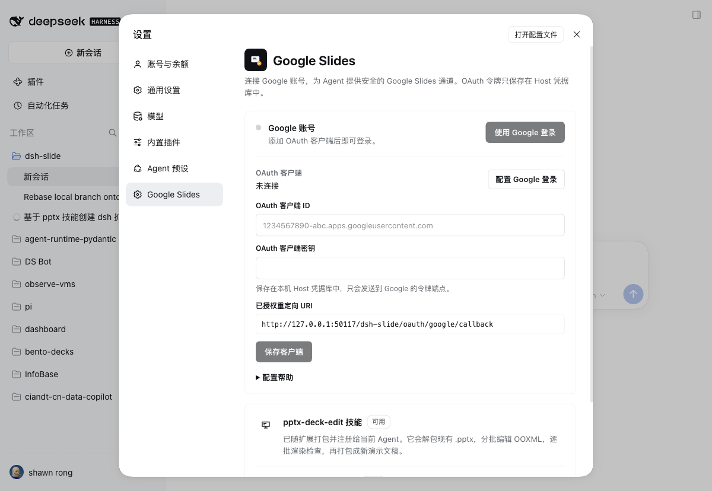

# Google Slides Deck Studio for DSH

A DSH extension for building and editing slide decks. It adds:

- two bundled skills — **`deck-design`** for building or rebuilding a deck with a diagram-first layout standard and per-slide text budgets, and **`pptx-deck-edit`** for edits that preserve an existing one;
- a **diagram-first pattern catalog** (boundary, swimlane, tree, staircase, trunk + glue, and more) with a python-pptx geometry kit, plus `deck_lint.py` checks for tables, prose walls, and text-only slides;
- a **Google account login** flow in **Settings → Google Slides**;
- a **`google_slides`** agent tool for listing, exporting, importing, and PDF-rendering Google Slides decks.

The model never receives an OAuth token. Tokens are stored in the Host credential store (`ctx.credentials`) and refreshed by the Host.



## Install

The bundle is already installed in the current `desktop` profile as `@local/dsh-slide`. To install it in another profile:

```text
plugin_manager install_bundle /Users/shawnr/Dev/dsh-slide
```

The package is a local directory bundle: `package.json` declares `dsh.bundle.patch`, and `cordis.patch.yml` inserts the `dsh-slide` Host row. The Client half registers a `settings.section` page.

## Upgrading from a pre-0.2.1 DSH

DSH 0.2.1 changed credential records to the `<scope>/<id>` key grammar. The Host validates the whole store while the `credentials` plugin loads, so one legacy record such as `dsh-slide.google.client` makes startup fail before any plugin — including this one — can repair it.

The code here already writes `dsh-slide/google-client` and `dsh-slide/google-account`. If you signed in with an older build, migrate the stored records once, with DSH stopped:

```bash
node scripts/migrate-credentials.mjs --dry-run   # show the planned renames
node scripts/migrate-credentials.mjs             # back up, then rewrite
```

The script reads `$DSH_HOME/.credentials.yaml` (default `~/.dsh/.credentials.yaml`), renames legacy `dsh-slide.*` record keys, keeps a timestamped `600` backup, and reports any other key that still violates the grammar. Start DSH again afterwards.

## Connect a Google account

The extension does not ship an OAuth client (a client ID identifies *your* Google Cloud project). Create one once:

1. Open [Google Cloud Console → Credentials](https://console.cloud.google.com/apis/credentials).
2. Create or select a project and enable **Google Drive API** under **APIs & Services → Library**.
3. Configure the **OAuth consent screen**. While the app is in **Testing**, add your Google account under **Test users**.
4. Create an OAuth client ID:
   - **Desktop app** is the simplest choice for this local Harness. Google accepts the loopback redirect used below.
   - **Web application** works too, but you must add the exact redirect URI to **Authorized redirect URIs**.
5. Open **Settings → Google Slides** in DSH, paste the client ID and client secret, and click **Save client**.
6. Click **Sign in with Google**. The Web UI opens Google's consent page; in the desktop app it opens in your default browser, and the page switches to the connected account when the callback lands.

The page displays the exact redirect URI to register:

```text
http://127.0.0.1:50117/dsh-slide/oauth/google/callback
```

If the Web GUI runs on another port, use the URI shown on the page. For a **Web application** client, the registered URI must match exactly.

### Desktop app

The desktop shell serves the Web UI from `dsh-app://app` and denies in-app popups, so **Sign in with Google** hands the consent page to your default browser instead. The settings page shows the handoff notice, keeps an **Open sign-in page** link, and polls the Host; it switches to the connected account when the browser callback arrives. Nothing needs to be copied back.

A **Desktop app** OAuth client is the least brittle choice for this path: Google accepts the loopback redirect on any port, so a changing Web/desktop port does not require editing **Authorized redirect URIs**. The Host's same-origin guard accepts both the bound Web origin and the desktop `dsh-app://app` origin.

### Scopes

- `openid`, `email`, `profile` — show which account is connected.
- `https://www.googleapis.com/auth/drive.file` — import new Slides files and access files this app created.
- `https://www.googleapis.com/auth/drive.readonly` — export existing Slides decks the user can read.

Google may require OAuth verification before these sensitive scopes can be used by accounts outside your test users.

### Configuration alternatives

Instead of saving the client in the UI, set these in the Host environment before starting DSH:

```bash
export GOOGLE_CLIENT_ID="…apps.googleusercontent.com"
export GOOGLE_CLIENT_SECRET="…"
```

Saved UI values take priority over environment values. The UI reports when it is using `GOOGLE_CLIENT_ID`.

## Agent usage

Both skills are registered from their bundled directories, with a short DSH-specific note appended at load time. The upstream `pptx-deck-edit` files are not modified; `deck-design` is part of this bundle.

### `/slide` command

Type `/slide <主题或要求>` in the composer to start a deck task without writing the prompt by hand. The command turns the brief into an ordinary user message and queues it with the live agent, so the work runs through the same inbox, session log, and turn lifecycle as a typed prompt.

The composed message tells the agent to use `deck-design` for a new deck (or `pptx-deck-edit` when editing an existing `.pptx`), follow the skill's three-slide cadence, keep the finished `.pptx` in the working directory, run `deck_lint.py` before delivery, and import to Google Slides when an account is connected. `/slide` with no brief returns a usage error.

The `google_slides` tool supports:

| action | purpose |
|---|---|
| `status` | Check whether a Google account is connected. |
| `list` | List Google Slides decks (optional Drive `query`, `limit`). |
| `export` | Download a Google Slides deck as `.pptx` into the workspace. |
| `pdf` | Download Google's own PDF rendering into the workspace. |
| `import` | Upload a local `.pptx` as a **new** Google Slides file. |

Example agent flow:

```text
google_slides export file_id=<deck-id> path=work/deck/original.pptx
# edit with pptx-deck-edit, or build with deck-design
python3 deck-design/scripts/deck_lint.py work/deck/final.pptx
google_slides import path=work/deck/final.pptx name="Q4 review (edited)"
google_slides pdf file_id=<new-id> path=work/deck/final-google.pdf
```

`export`, `pdf`, and `import` only accept paths inside the current session workspace. Symlink escapes are rejected.

## Decks panel

The left sidebar gains **Decks** (中文界面「幻灯片」). It lists every deck `google_slides` imported, exported, or rendered, newest first. Click a card to return to the conversation that worked on it and open the deck in the right sidebar's browser, next to the chat. **Google Slides** opens the same deck in a new tab, and the trash button removes only the local record.

A record holds the Drive file id, title, link, the session that touched it, the workspace path, the last local file, and timestamps. It never holds a token. Records live in `$DSH_HOME/dsh-slide/decks/<hash>.json` (default `~/.dsh/dsh-slide/decks/`), survive restarts, and are pruned to the 200 most recent.

The panel reads on open, when the window becomes visible again, and every 15 seconds. It does not call Google: when the record's conversation was archived or deleted, or the right sidebar is unavailable, the deck opens in a normal browser window instead.

Two limits are deliberate for this version: previews are drawn locally (Drive thumbnails need an extra proxy), and the panel has no comments yet.

## Deck quality gate

`deck-design` adds a build workflow and an automated gate for the failure mode in most agent decks: dense pages, 6–8 pt type, the same four-card layout on every slide, and copy that sounds like a model.

```text
python3 deck-design/scripts/deck_lint.py deck.pptx
python3 deck-design/scripts/deck_lint.py deck.pptx --json
```

It reports a content and design score and hard failures for:

- AI tells such as “不是…而是…”, “一页看懂”, “诚实标注”, meta citations, and invented section tags such as `01 · 今天`;
- type below 9 pt (a hard failure), 9–11 pt runs outside the footer (a warning), body copy over the density budget, and more than ~14 shapes per slide;
- fewer than four distinct body compositions in a deck of ten or more slides;
- low-contrast text and text outside the canvas.

During review, the two agent-built proposals scored in the low 30s and the human-written comparison in the high 70s. The score is a tripwire, not a grade — the visual pass still decides.

`deck-design/references/ANTI-SLOP.md` lists the patterns and rewrites; `DESIGN-SYSTEM.md` gives the type scale, grid, density budget, and eight layout archetypes; `SPATIAL.md` gives the PPTX vertical budget and heading/footer rules; `QUESTIONS.md` gives the ask-before-building protocol.

A template asset is not slop: a footer logo supplied by the template stays at its position and size, with the light/dark variant the template specifies. Take that size from the template master, not from a brand-guide display slide. If the tagline is unreadable at the footer size, use the template's compact mark instead of enlarging the lockup. The rules only forbid inventing, moving, recolouring, or redrawing a mark.

## Review cadence

`deck-design` builds in batches of three. After each batch the agent renders the three slides, composes a labelled 3-up grid, and posts it with a one-line summary, the local `.pptx` path, and the Google Slides link when it exists. It keeps building by default; it pauses only when the user asks for interactive review or a decision blocks the next batch.

The message template, question patterns, and feedback rules are in `deck-design/references/REVIEW-CADENCE.md`; `deck-design/scripts/checkpoint.py` composes the grid. If the client cannot render inline images, the agent calls `present` with the grid so the user gets a preview card.

## How it is put together

| File | Role |
|---|---|
| `index.js` | Host plugin: skill registration, the `/slide` command, OAuth loopback flow, credential records, Drive API, `google_slides` tool, HTTP routes. |
| `decks.js` | Host: durable deck list, atomic JSON records, and the 200-record prune. |
| `client.js` | Client plugin: `settings.section` page, **Decks** panel (`main` + `sidebar.panellist`), localized en/zh dictionaries, sign-in popup and status polling. |
| `cordis.patch.yml` | Inserts the Host row. |
| `locale/{en,zh}.json` | Plugin Manager title and description. |
| `icon.svg` | Original deck/slide icon. |
| `pptx-deck-edit/` | The upstream edit skill (unchanged), exposed with a runtime note. |
| `deck-design/` | The build/rebuild skill: copy standard, design system, space math, question protocol, 3-slide progress grid (`checkpoint.py`), and `deck_lint.py`. |

Credential records:

- `dsh-slide/google-client` — saved OAuth client ID/secret.
- `dsh-slide/google-account` — access token, refresh token, expiry, scope, and account profile.

Routes:

- `GET  /dsh-slide/api/status`
- `GET/POST /dsh-slide/api/config`
- `POST /dsh-slide/api/google/start`
- `POST /dsh-slide/api/google/disconnect`
- `GET  /dsh-slide/oauth/google/callback`
- `GET  /dsh-slide/api/drive/files`
- `GET  /dsh-slide/api/decks`
- `POST /dsh-slide/api/decks/open`
- `POST /dsh-slide/api/decks/forget`

## Security notes

- The browser never receives an access or refresh token; it only sees connection status and profile fields.
- OAuth uses PKCE (`S256`) and a single-use `state` with a 10-minute lifetime.
- Signing out deletes the credential record and best-effort revokes the Google grant.
- OAuth client changes and disconnects require a same-origin request: the bound Web origin, a loopback alias, or the desktop shell's `dsh-app://app` origin.
- Client secret and tokens live in the Host credential store, not in `cordis.patch.yml`.
- Deck records (`~/.dsh/dsh-slide/decks/`) hold titles, Drive file ids, session ids, workspace paths, and last export paths. They never hold a token.
- The Google Drive export endpoint enforces Google's own 10 MB presentation export limit.

## Verification

- Host and Client JavaScript pass `node --check`.
- A stub-Context test of `index.js` registers `/slide` with the `<主题或要求>` hint; its handler queues exactly one user-role message carrying the brief, and an empty brief returns the usage error.
- The bundle deactivates and reactivates with `application: applied`; the Host command service is present, so registration runs in the live profile.
- `deck-design` registers alongside `pptx-deck-edit`; its lint runs against a real 22-slide deck and a 28-slide comparison deck.
- `checkpoint.py` composes a labelled 3-up grid from rendered PNGs (2400×608 for three 16:9 slides).
- `npm run smoke` (`scripts/smoke-decks.mjs`) passes: `decks.js` list order, touch, forget, invalid ids, hostile fields, 20 concurrent writers, and the 200-record prune.
- The three deck routes pass in the same stub Host: list, open (updates `openedAt`), 404 for an unknown deck, 403 for a foreign origin, and forget.
- Live slot inspection shows `dsh-slide.decks` active in both `main` and `sidebar.panellist`. The Host half (the three deck routes) and the panel's visual state still need a check after the app restarts; visual verification is unavailable from this session.
- `deck_lint.py` flags decorative tags such as `01 · 今天` as `copy.eyebrow-tag`, separately from hard copy failures.
- Verified live on DSH 0.2.1-rc.3: Host boot, credential read/write/delete, `google_slides` schema, `pptx-deck-edit` catalog entry, Settings section, and a Drive `list` against a connected account.
- The bundle installed with `application: applied` and no warnings.
- `pptx-deck-edit` appears in the live skill catalog; loading it returns the bundled instructions and resource directory.
- `google_slides` appears in the live tool schema with `status`, `list`, `export`, `import`, and `pdf`.
- `GET /dsh-slide/api/status` returns the redirect URI and connection state.
- OAuth start returns a Google authorization URL with PKCE and `state`; the desktop shell hands it to the system browser, and the Web popup reaches Google's consent/error page.
- The same-origin guard accepts `dsh-app://app` and loopback aliases while rejecting foreign origins and foreign loopback protocols.
- The Settings page renders in Chinese/English and light/dark themes (screenshots in `screenshots/`).

Not verified without user credentials: an actual Google consent round-trip and a live Drive export/import. Those need a real OAuth client ID/secret and a Google account.

The composer's `/` menu entry and a real `/slide` task turn were not exercised from this session: the standalone Web page requires the process launch token, and invoking the command would start a new deck turn. The registration path and the queued message shape are covered by the stub-Context test above.

## Limitations

- This repository does not include Google OAuth credentials; each user supplies their own client.
- Google's testing-mode consent screen limits sign-in to added test users.
- In a normal browser, allow the popup for the inline flow. The desktop shell opens the system browser instead; the Web flow falls back to a full-page redirect only if the popup is unavailable.
- A Web application OAuth client must have the exact redirect URI registered; a Desktop app client is less brittle for local use.