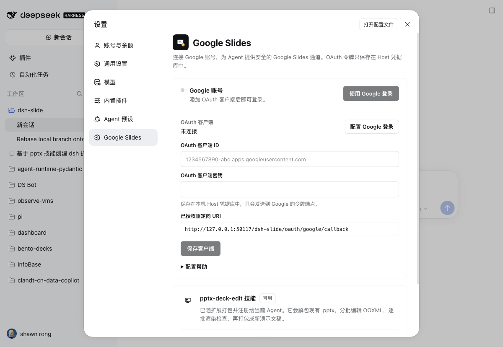

# dsh-plugin-google-slides

[English](README.md) | 中文

## 概要

一个用来做 deck、改 deck 的 DSH 插件。它带两套技能：`deck-design` 从零搭或整版重做，`pptx-deck-edit` 在既有 `.pptx` 里改内容而不破坏原设计；另外补齐这套流程需要的东西——Google 账号登录、在 Google Slides 与本地 `.pptx` 之间搬文件的 `google_slides` 工具，以及一个能把用过的 deck 重新打开的「幻灯片」面板。

没有构建步骤，token 不进模型上下文，仓库里不放任何凭据。

| 装完会多出 | 位置 |
|---|---|
| `deck-design`、`pptx-deck-edit` 技能 | 技能目录 |
| `google_slides` 工具（`status`、`list`、`export`、`import`、`pdf`、`comments`） | 智能体工具 |
| **Google Slides** 账号设置 | 设置页 |
| **Decks** 面板（中文「幻灯片」） | 左侧边栏 |
| `/slide <主题或要求>` 命令 | 输入框 |

## 目录

- [环境要求](#环境要求)
- [安装](#安装)
- [连接 Google 账号](#连接-google-账号)
- [怎么用](#怎么用)
- [隐私与安全](#隐私与安全)
- [常见问题](#常见问题)
- [已知限制](#已知限制)
- [开发](#开发)

## 环境要求

- **DSH 0.2.1-rc.3 或更新版本。** `package.json` 里声明了 `engines.dsh`，插件管理器在安装阶段就会拒绝过旧的 Harness，而不是等到运行时报错。
- **Python 3.9+**，且 `python3` 能找到 `python-pptx`、`lxml`、`Pillow`。DSH 桌面版自带的运行时已经包含这三个包；源码或 CLI 安装时执行 `pip install python-pptx lxml pillow`。
- **LibreOffice（`soffice`）和 poppler（`pdftoppm`）**，用于视觉检查（`pptx-deck-edit/scripts/render.sh`）。只跑 lint、或用 Google 自己的 PDF 渲染时可以不要。
- **你自己的 Google Cloud OAuth 客户端**，只有用到 Google Slides 那部分才需要。插件本身不附带任何凭据。

```bash
# macOS
brew install --cask libreoffice && brew install poppler
# Debian / Ubuntu
sudo apt install libreoffice-impress poppler-utils
```

## 安装

在 Web 或桌面版里打开 **插件（Plugins）→ 添加插件**，把下面任意一种贴进输入框：

```text
dsh-plugin-google-slides                                        # npm 包名
https://github.com/ShawnRong/dsh-slide                          # GitHub 仓库
/absolute/path/to/dsh-slide                                     # 本地目录
```

命令行等价操作：

```bash
dsh plugin add dsh-plugin-google-slides
```

插件装进**当前 profile**，该 profile 下的每个会话都能用。在同一个插件页关掉或移除它，Host 行和前端面板会一起消失。

装完确认一下：

- 设置页出现 **Google Slides** 分区；
- 左侧边栏出现 **Decks / 幻灯片**；
- 技能目录里有 `deck-design` 和 `pptx-deck-edit`；
- 智能体能调 `google_slides`，`action: "status"` 有返回。

## 连接 Google 账号

插件不带 OAuth 客户端——client ID 标识的是**你**的 Google Cloud 项目。建一次即可：

1. 打开 [Google Cloud Console → 凭据](https://console.cloud.google.com/apis/credentials)。
2. 新建或选择项目，在 **API 和服务 → 库**里启用 **Google Drive API**。
3. 配置 **OAuth 同意屏幕**。应用处于**测试**状态时，把自己的 Google 账号加进**测试用户**。
4. 创建 OAuth 客户端 ID：
   - **桌面应用**最省事，Google 接受任意端口的回环地址重定向；
   - **Web 应用**也行，但必须登记精确的重定向 URI。
5. 在 DSH 里打开 **设置 → Google Slides**，填入 client ID 和 client secret，点**保存客户端**。
6. 点**使用 Google 登录**。Web 界面会在弹窗里打开 Google 同意页；桌面版交给系统默认浏览器，回调到达后页面会自己切到已连接的账号，不需要往回粘任何东西。



页面上会显示需要登记的重定向 URI：

```text
http://127.0.0.1:<port>/dsh-slide/oauth/google/callback
```

`<port>` 是 Web 界面当前监听的端口，端口可能每次启动都变，所以以页面上显示的为准。用**桌面应用**类型的客户端可以完全绕开这个问题。

### 权限范围

| Scope | 用途 |
|---|---|
| `openid`、`email`、`profile` | 显示连接的是哪个账号。 |
| `https://www.googleapis.com/auth/drive.file` | 导入新的 Slides 文件、访问本应用创建的文件。 |
| `https://www.googleapis.com/auth/drive.readonly` | 导出用户有读权限的既有 Slides 文稿。 |

若账号不在测试用户名单里，Google 可能要求先完成 OAuth 审核，才能使用这些敏感权限。

### 不开设置页的配置方式

启动 DSH 前在 Host 环境里设置；界面上保存的值优先级更高。

```bash
export GOOGLE_CLIENT_ID="…apps.googleusercontent.com"
export GOOGLE_CLIENT_SECRET="…"
```

## 怎么用

### 两套技能

| 技能 | 用在什么时候 | 强制什么 |
|---|---|---|
| `deck-design` | 新建 deck，或整版重做 | 一页一个主张、结构图优先、每页文字预算、中文措辞规范、每页 speaker note、每三页一次 3-up 预览、交付前跑 `deck_lint.py`。 |
| `pptx-deck-edit` | 在既有 deck 里做局部修改 | 离线 OOXML 往返：导出 → 解包 → 分批改 → 渲染检查 → 打包 → 重新导入。品牌元素保持原位原尺寸。 |

`deck-design` 自带一套参考文档：`DIAGRAM-PATTERNS.md`（boundary、swimlane、tree、staircase、trunk + glue）、`DESIGN-SYSTEM.md`（字号阶梯、栅格、密度预算、版式原型）、`SPATIAL.md`（PPTX 纵向空间预算）、`ANTI-SLOP.md`（AI 腔与改写）、`ZH-COPY.md`（中文措辞与两组前后对照）、`SPEAKER-NOTES.md`、`QUESTIONS.md`、`REVIEW-CADENCE.md`。

### `/slide <主题或要求>`

在输入框里打 `/slide 给管理层做一份 10 页的 Q4 复盘`。这条命令把需求转成一条普通用户消息排进当前会话，所以流程、会话记录和一轮 turn 的生命周期跟你手打提示词完全一样。组装好的消息会选好技能、写清结构图和措辞规则、要求每页备注、每三页贴 3-up 预览、成品 `.pptx` 留在工作目录、交付前跑 lint、最后只导入一次 Google Slides。

不带需求直接发 `/slide` 会返回用法提示。

### `google_slides` 工具

| action | 作用 |
|---|---|
| `status` | 查 Google 账号是否已连接。 |
| `list` | 列出 Google Slides 文稿（可选 Drive `query`、`limit`）。 |
| `export` | 把文稿下载成 `.pptx` 到工作区。 |
| `pdf` | 下载 Google 自己渲染的 PDF 到工作区。 |
| `import` | 把本地 `.pptx` 上传成一个**新的** Google Slides 文件。 |
| `update` | 直接替换一份已有 deck 的内容：文件 id、链接、共享和评论都保留，旧内容留在版本历史里。 |
| `comments` | 列出一份 deck 里未解决的评论：作者、引用的原文、回复，以及一条能直接打开该评论的链接。 |

一次典型往返：

```text
google_slides export file_id=<deck-id> path=work/deck/original.pptx
# 用 pptx-deck-edit 改，或用 deck-design 重新搭
python3 deck-design/scripts/deck_lint.py work/deck/final.pptx
google_slides update file_id=<deck-id> path=work/deck/final.pptx   # 同一份文件、同一个链接
google_slides pdf file_id=<deck-id> path=work/deck/final-google.pdf
```

`update` 把打好的 `.pptx` 写回用户正在看的那份 deck，链接、共享和评论线程都不变；被替换的内容留在 Google 的版本历史里。用户想要一份副本时再用 `import`。

`export`、`pdf`、`import`、`update` 只接受当前会话工作区内的路径，符号链接逃逸会被拒。

### 评论

`comments` 回答的是“评审说了什么”。它返回一份 deck 上未解决的评论：作者、这条评论引用的原文、已有回复、是否已解决，以及一条能直接定位到该评论的 `disco` 链接：

```text
google_slides comments file_id=<deck-id>
```

评论锚定的是**文字**，不是页码，所以 Agent 需要在导出的页面里搜这段原文（`inventory.py`）才知道是哪一页。整条桥只做到“读”：

- 这里的评论是**只读**的。插件不会替你回复或标记已解决；`update` 写回改好的 deck 后，Agent 会列出哪几条评论已经处理过，由你去关闭。
- `include_resolved: true` 会把已解决的线程一并返回，默认只给未解决的。
- 只能读的 deck 也能列评论：读取用的是登录时已经拿到的 `drive.readonly`。

### 幻灯片面板

左侧边栏多一个 **Decks（幻灯片）**，按时间倒序列出工具导入、导出、渲染过的每一份 deck。点卡片会回到当时对话，并在右侧边栏（聊天旁边）打开这份 deck；**Google Slides** 在新标签页打开；垃圾桶只删本地记录，不动 Drive 文件。

记录里有 Drive 文件 id、标题、链接、来自哪个会话、工作区路径、最近一次本地文件和时间戳，不含任何 token。记录存在 `$DSH_HOME/dsh-slide/decks/`（默认 `~/.dsh/dsh-slide/decks/`），重启后还在，超过 200 条自动淘汰最旧的。面板在打开时、窗口重新可见时、以及每 15 秒刷新一次。

卡片左上角显示未解决评论数。这是面板唯一会调 Google 的地方：只对前 12 张卡片发一次批量请求，Host 缓存一分钟，未登录时直接跳过。评论正文不进面板——卡片只告诉你还有几条没解决，具体内容由 Agent 去读。

### 质量门槛

```bash
python3 deck-design/scripts/deck_lint.py deck.pptx
python3 deck-design/scripts/deck_lint.py deck.pptx --json
```

lint 给出一个内容与设计分，并对这些情况判硬失败：某页没有 speaker note（`--no-notes` 可关掉这条检查）；AI 腔，比如「不是…而是…」「一页看懂」、元信息引用、`01 · 今天` 这类虚构小节标签；小于 9 pt 的字号；页脚之外 9–11 pt 的正文；正文超出密度预算；单页超过约 14 个形状；十页以上的 deck 里正文版式少于四种；对比度不足；文字出画布；以及中文措辞问题（光杆结果补语、解释作者怎么核对的脚注、翻译腔、全篇数字空格不统一）。

分数是绊线，不是评分。当初做这套检查时，智能体产的方案在 30 分出头，人工写的对照稿在 70 分以上；最终仍然由视觉检查决定。

## 隐私与安全

- 模型和浏览器都拿不到 access token 或 refresh token。token 存在 Host 凭据库（`ctx.credentials`），由 Host 负责刷新。
- OAuth 使用 PKCE（`S256`），`state` 一次性、10 分钟过期。
- 退出登录会删除凭据记录，并尽力撤销 Google 授权。
- 改客户端和断开连接都要求同源请求：绑定的 Web 源、回环别名，或桌面壳的 `dsh-app://app`。
- client secret 与 token 只进 Host 凭据库，不进 `cordis.patch.yml`，也不进仓库。
- deck 记录只含标题、Drive 文件 id、会话 id、工作区路径和导出路径，不含 token。
- 读评论复用 `drive.readonly` 授权；线程正文只交给 Agent，不写进 deck 记录。
- 插件以你的权限在进程内运行，请只安装你信任的来源。

凭据记录键：`dsh-slide/google-client`（保存的 OAuth 客户端）、`dsh-slide/google-account`（access token、refresh token、过期时间、scope、账号资料）。

## 常见问题

| 现象 | 原因与处理 |
|---|---|
| `status` 显示未连接、登录按钮是灰的 | 还没保存 OAuth 客户端。在**设置 → Google Slides**填 client ID 和 secret，或在启动前设 `GOOGLE_CLIENT_ID`。 |
| Google 报 `redirect_uri_mismatch` | 按设置页显示的 URI 精确登记，或改用**桌面应用**类型的客户端。 |
| 明明有文稿，`list` 却是空的 | 连错账号，或文稿没共享给这个账号；`drive.readonly` 覆盖你有读权限的文稿。 |
| 导出报体积错误 | Google 不接受超过 10 MB 的演示文稿导出。减少内嵌图片，或直接在 Google Slides 里下载。 |
| `missing soffice` / `missing pdftoppm` | 装 LibreOffice 和 poppler，视觉检查要调这两个命令。 |
| `ModuleNotFoundError: pptx` | 往 `python3` 实际指向的解释器里装 `python-pptx`。 |
| 桌面版点登录开了一个空白页 | 符合预期：壳把同意页交给系统浏览器，同时轮询 Host。标签页被关掉就点**打开登录页**。 |
| 面板提示会话不见了 | 记录比会话活得久，卡片会退化成用普通浏览器窗口打开。 |

## 已知限制

- 不附带 Google 凭据，每个用户自己建 OAuth 客户端。
- 同意屏幕处于**测试**状态时，只有被加入的测试用户可以登录。
- 普通浏览器里这条流程需要弹窗；桌面版走系统浏览器。
- 面板里的预览是本地绘制的，Drive 缩略图需要额外的代理。
- 评论桥只读：回复和标记已解决仍然在 Google Slides 里做，插件只要 `drive.file` 之外的读权限。
- 评论计数只对这台机器登记过的 deck 发起 Drive 请求，面板不会被用来探测任意文件 id。
- `/slide` 自己的提示文案是中英双语的，但两套技能里的文案规范以中文为先：`deck-design` 写清了规则，`ZH-COPY.md` 是中文的对照范例；其他语言的 deck 沿用同一套结构，lint 的措辞检查会宽松一些。

## 开发

架构、HTTP 路由、凭据布局、本地检查和验证记录见 [docs/DEVELOPMENT.md](docs/DEVELOPMENT.md)。

```bash
node --check index.js && node --check decks.js && node --check comments.js && node --check client.js
npm run smoke        # deck 存储 + 评论桥
python3 deck-design/scripts/deck_lint.py <deck>.pptx
```

## 许可

[MIT](LICENSE)